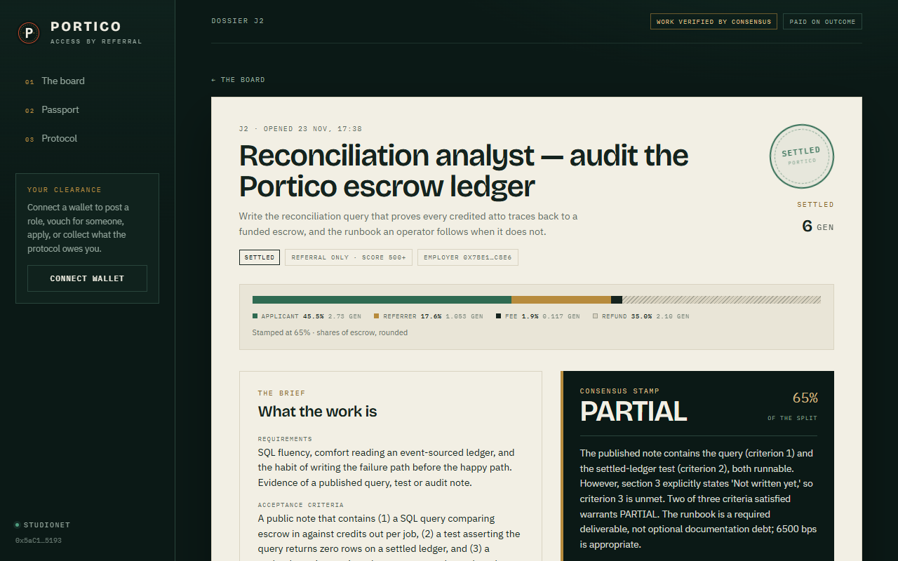

# Portico

**Access by referral. Paid on outcome.**

Portico is a hiring protocol for work that cannot be checked by a form. An employer funds the entire
hire into an intelligent contract and writes the acceptance criteria in plain language. A referrer
stakes a bond to open the door for one candidate. After delivery, GenLayer validators independently
read the committed evidence and stamp a verdict. Escrow splits itself at that verdict: the applicant
is paid for the work, the referrer is paid for the introduction, and the employer is refunded whatever
the work did not earn.

Nobody approves the payment. No operator key can redirect it.



```
employer funds ──► referral opens ──► validators screen ──► hire ──► delivery
                                                                        │
                    applicant payout ◄── escrow splits ◄── verdict stamp ┘
                    referrer bounty  ◄──
                    employer refund  ◄──
```

| | |
| --- | --- |
| **Contract** | `contracts/portico.py` — one intelligent contract, no dependencies |
| **Network** | GenLayer Studionet · chain id `61999` |
| **Live dossiers** | [`0x5aC11FD2…5193`](https://explorer-studio.genlayer.com/address/0x5aC11FD294a0E883a30802FAE20c8F148D975193) — `J1` settled at 100%, `J2` at 65% after an appeal upheld the partial |
| **Interface** | 18 writes · 16 views |
| **Consensus** | leader/validator re-derivation on screening, delivery and appeal |
| **Tests** | 64 direct-mode tests, 0 failed |
| **Frontend** | Vite + React 19 + genlayer-js, talks to the contract directly |

Review notes: [`docs/review-response.md`](docs/review-response.md) maps the recurring GenLayer review
themes (validator agreement, authenticated disputes, stall exits, evidence binding) to this code.

---

## Why this needs GenLayer

A deterministic contract can hold escrow and split it. It cannot answer the two questions this
product is made of:

1. **Does this person actually clear the door?** The applicant's evidence is a portfolio, a
   repository, a published paper, a reference letter. Deciding whether it substantiates the role is
   a judgement over unstructured, untrusted content.
2. **Does this delivery satisfy the brief?** The employer wrote acceptance criteria in language, not
   in code. Whether a pull request, a design file or a report meets them is exactly the kind of
   question validators should answer and a `require()` should not pretend to.

Portico puts those two judgements on chain, ties them to money, and keeps everything arithmetic
deterministic. That boundary is the whole design:

| Layer | Owns |
| --- | --- |
| Frontend | Wallet, forms, previews, cached reads, transaction progress |
| GenLayer contract | Escrow custody, bonds, deadlines, payout splits, reputation, withdrawal balances |
| Validators | Screening verdict, delivery verdict, appeal verdict |
| External sources | The evidence itself — never trusted as instructions, only as material to judge |

## The lifecycle

```
OPEN ──refer──► OPEN ──apply──► OPEN ──screen──► OPEN ──hire──► HIRED ──deliver──► DELIVERED
  │                                                                                  │
  ├── cancel / expire ──► CANCELLED / EXPIRED                    adjudicate ─────────┤
  │                                                                    │             │
  │                                                                    ▼             │
  │                                                                 VERDICT ◄────────┘
  │                                                                   │  │
  │                                                        appeal ────┘  │ ──── settle
  │                                                           │          │      (after window)
  │                                                           ▼          ▼
  │                                                        APPEALED ──► VERDICT ──► SETTLED
  │                                                           │ (both cases on file)
  │                                                           └── resolve_appeal
  │
  ├── hire never delivers ──► UNFULFILLED
  └── no verdict 7 days after delivery ──► STALLED (refund)
```

- **OPEN** while the application window runs. Referrals and applications are accepted.
- **HIRED** at the employer's choice, but only for an application that validators have screened
  `ELIGIBLE` or `PARTIAL`. The winning referral's bond stays locked; every other bond is returned.
- **DELIVERED** when the applicant commits a summary plus evidence URLs before the deadline.
- **VERDICT** after consensus stamps `PASS`, `PARTIAL` or `FAIL` with an exact payout bucket. A
  delivery that could not be read stays `DELIVERED` so the evidence can be repaired.
- **APPEALED** once, by either party, with a bond. The other party gets a fixed two-day window to file
  its own authenticated answer; resolution opens when both cases are on file or the window closes.
- **SETTLED** after the appeal window (or immediately after both appeal cases are on file).
  Settlement writes a withdrawable credit for every payee.
- **STALLED** if no verdict exists seven days after delivery. Either party can close the dossier: the
  employer recovers the escrow, the referrer recovers the bond, and the applicant is recorded as
  stalled, not failed. Adjudication is permissionless, so the applicant can force a verdict at any
  point during that window.

## What the validators decide

### 1. Screening — does the referred applicant clear the door?

`review_application` fetches up to four committed URLs, compacts them to text, and asks a model
whether the evidence substantiates the role requirements.

- `ELIGIBLE` — the sources show the core requirements are met.
- `PARTIAL` — some evidence exists, a core requirement is unproven. The employer may still hire.
- `INELIGIBLE` — the sources show a core requirement is missing. Hire is blocked.
- `FRAUD` — the evidence is fabricated, copied from someone else, or contradicts the candidate's own
  claims. The application is rejected **and the referrer's bond is paid to the employer**.
- `UNVERIFIABLE` — nothing could be read. This is not final; the employer can retry.

The validator reruns the same fetch and judgement and must reach the same **gate**. `ELIGIBLE` and
`PARTIAL` are two shades of `QUALIFIED`: both allow the hire and pay the same, so they may differ.
`INELIGIBLE`, `FRAUD` and `UNVERIFIABLE` are materially different outcomes and must match exactly.
The advisory 0–100 fit score is stored for the passport but does not gate consensus. A positive
screening that cites no fetched source is voided instead of being written.

### 2. Delivery — does the work satisfy the acceptance criteria?

`adjudicate` reads the submitted artifacts and asks for a ratio, not a feeling:

| Verdict | Meaning | Escrow |
| --- | --- | --- |
| `PASS` | Every criterion is evidenced | 100% of the applicant share |
| `PARTIAL` | Core deliverable exists, at least one criterion unmet | 5–85% in 5-point steps |
| `FAIL` | Absent, unrelated, fabricated, or contradicted | Ratio 0, employer refunded |
| `UNDETERMINED` | No source could be read | No verdict written |

The validator reruns the judgement and must reach the same verdict **and the exact same ratio
bucket**. `PASS` is a single value, 10,000 bps, because "every criterion is met" cannot honestly pay
95%. A partial is snapped to 500 bps steps (500, 1,000, … 8,500), and the stored bucket is the one
both validators agreed on. A positive verdict that cites no fetched source is voided. The accepted
leader result is what lands on chain; the rationale, the cited URLs (filtered to URLs actually
fetched) and the evidence status are stored with it.

A delivery that stays unreadable after four finalized attempts has a bounded exit: seven days after
delivery, either party can call `recover_stalled_escrow` and refund the employer. Funds cannot be
locked by a permanently failing fetch.

### 3. Appeal — should the verdict move?

One appeal per dossier, filed by the employer or the applicant. The appellant's statement opens a
two-day window in which the **other party** files its own answer; neither statement is evidence, and
the contract refuses to resolve until both cases are on file or the window has closed. The panel then
re-reads the same record and is told to overturn the prior verdict when the evidence does not support
it and to uphold it when it does. The bond follows the outcome:

- verdict moves in the appellant's favour → bond returned;
- verdict holds or moves against the appellant → bond paid to the other party;
- record unreadable → prior verdict stands, bond returned, settlement unlocked.

## The money

Let `escrow` be the funded amount, `applicant_bps + referrer_bps + fee_bps = 10,000`, and `ratio` the
stamped verdict.

```
applicant = escrow × applicant_bps × ratio
referrer  = escrow × referrer_bps  × ratio    (only if a referrer was selected)
fee       = escrow × fee_bps       × ratio
refund    = escrow − applicant − referrer − fee
```

`ratio` is always a consensus value: 100% for a pass, a 5-point bucket for a partial, zero for a
fail. Integer division leaves the dust with the employer. If an open role ends without a referrer, the
referrer share is refunded rather than burned. A `FAIL` or a stalled recovery returns the whole
escrow; a stalled recovery pays no fee and returns the referral bond.

**Bonds.**

| Bond | Amount | Returns | Forfeits |
| --- | --- | --- | --- |
| Referral | Fixed per role, ≥ 0.05 GEN | Role closes, another candidate hired, hire delivered, or unfulfilled | Fabricated evidence: 100% to employer. Failed work: 50% to employer |
| Appeal | 5% of escrow, with a floor | Verdict moves in the appellant's favour, or the record is unreadable | Verdict holds or moves against the appellant |

A stalled delivery is not a forfeiture. The employer gets the escrow back, the referrer gets the bond
back, and the applicant is counted as `stalled` rather than `failed`; the score formula does not read
that counter. The point is to bound the lock, not to punish a transient web failure.

**Payment is a pull, not a push.** Settlement credits a withdrawable balance inside the contract; the
payee calls `withdraw()` to release it. This removes a whole class of griefing (a reverting recipient
cannot block a settlement) and keeps one transaction from fanning out five external messages. The
credit is still automatic and final: no one can cancel or redirect it.

## Portable reputation

Every applicant and referrer carries a score from 0 to 1,000, derived deterministically from stored
counters — no model call:

```
good     = 2 × passes + partials + 2 × referrer_successes
possible = 2 × (candidate_jobs + referrer_hires)
base     = 200 + 600 × (good + 1) ÷ (possible + 2)
score    = clamp(base + min(80, 4 × possible) − 50 × misses, 0, 1000)
```

`misses` counts failed deliveries, no-shows, slashed referrals and candidates screened out — not
stalled deliveries. A fresh
address starts at 500. The smoothing means one bad outcome does not erase a record and one good
outcome cannot farm a reputation.

`get_passport(address)` returns the counters, the score, and a SHA-256 digest over the canonical
payload. Any other contract can read it, require a threshold, and verify the digest. Referral-gated
roles use the score directly: a referrer below `min_referrer_score` cannot open the door.

## Repository

```
contracts/portico.py        the intelligent contract (pinned py-genlayer runner)
tests/test_portico.py       64 direct-mode tests: lifecycle, money, bonds, validators
tests/integration/          optional consensus smoke test against a live network
frontend/                   Vite + React app: landing, board, dossier, passport, protocol
frontend/scripts/live-demo.mjs   drives the real lifecycle against Studionet
docs/architecture.md        state machine, storage layout, threat model, invariants
docs/review-response.md     mapping of the recurring GenLayer review themes to this code
```

## Run it

### Contract

```bash
pip install -r requirements.txt
genvm-lint check contracts/portico.py
python -m pytest tests/ -q
```

### Deploy

```bash
genlayer network set studionet

genlayer deploy --contract contracts/portico.py \
  --args 300 50000000000000000 1000000000000000000 10000000000000000
# 300 bps fee · 0.05 GEN referral bond · 1 GEN minimum escrow · 0.01 GEN appeal floor
```

### Frontend

```bash
cd frontend
npm install
cp .env.example .env.local
# set VITE_CONTRACT_ADDRESS to the deployed address
# (the checked-out copy already points at the live dossier)
npm run dev
```

The app opens on a landing page at `#/` — the thesis, the four moves, the judgement, the settlement
arithmetic and the live board, read from the contract. The workspace sits behind it at `#/board`,
`#/job/<id>`, `#/passport` and `#/protocol`. Every view is static and responsive; the landing page
degrades to a single column on a phone.

The app reads directly from the contract. Connecting a wallet unlocks posting, vouching, applying,
reviewing, hiring, delivering, appealing, settling and withdrawing.

### Deploy to Vercel

Set the Vercel project's **Root Directory** to `frontend`. Vercel detects Vite, installs from
`frontend/package-lock.json`, runs `npm run build` and serves `frontend/dist`; [`frontend/vercel.json`](frontend/vercel.json)
pins the build command and output directory. `frontend/.env.production` pins the live contract for the
deployed build — override `VITE_CONTRACT_ADDRESS` in the project settings to point the site elsewhere.
Routing is hash-based, so no rewrites are needed.

```bash
cd frontend
npx vercel --prod   # after `npx vercel link`, with the project root at frontend/
```

### Live consensus run

`frontend/scripts/live-demo.mjs` drives a dossier through every stage with real web reads and real
model calls. Two scenarios are built in: `sdk` (documentation, settled at a full pass) and `ledger`
(reconciliation, a deliberately partial deliverable). Set `SCENARIO` and `STATE_PATH` to keep their
state apart, and `APPELLANT=applicant|employer` to pick the appeal side.

| Dossier | Role | Escrow | Verdict | Applicant | Referrer | Fee | Refund |
| --- | --- | --- | --- | --- | --- | --- | --- |
| `J1` | SDK documentation engineer | 10 GEN | `PASS` · 100% | 7.000 | 2.700 | 0.300 | 0.000 |
| `J2` | Reconciliation analyst | 6 GEN | `PARTIAL` · 65% | 2.730 | 1.053 | 0.117 | 2.100 |

Both dossiers were appealed and re-read by a second consensus round. `J1` upheld a pass and forfeited
the employer's bond; `J2` upheld a partial and forfeited the applicant's bond. See
[`docs/architecture.md`](docs/architecture.md) for the transcripts.

```bash
cd frontend
CONTRACT=0x... EMPLOYER_PK=0x... REFERRER_PK=0x... APPLICANT_PK=0x... \
  node scripts/live-demo.mjs post
# then: refer, apply, screen, hire, deliver, adjudicate, withdraw, appeal, reply, resolve, settle, show
# SCENARIO=ledger APPELLANT=applicant node scripts/live-demo.mjs appeal
```

## Test coverage

64 direct-mode tests, each running the contract in-process in about 30ms:

- posting, escrow minimums, split validation, access modes, deadline bounds;
- referral bonds, self-referral blocks, per-referrer caps, reputation gates;
- referral-only access, duplicate applications, evidence validation;
- screening verdicts, fraud slashing, unverifiable retries, validator disagreement;
- hire eligibility, bond returns for losing referrals, application closure;
- delivery deadlines, permissionless adjudication, attempt caps, evidence repair;
- payout maths for `PASS`, `PARTIAL` and `FAIL`, no-referrer refunds;
- appeal bonds, overturns, forfeits, unreadable appeals, the reply window and forged replies;
- expiry, cancellation, unfulfilled refunds, stalled-delivery recovery;
- reputation updates, passport digest stability, withdrawal accounting;
- exact settlement conservation: ledger entries equal escrow plus bonds, credits equal the ledger;
- board pagination.

The suite also asserts validator behaviour directly: a flipped verdict is rejected, a different
screening gate is rejected while `ELIGIBLE`/`PARTIAL` agree, a pass cannot carry a different ratio,
and a positive verdict without a fetched citation is voided.

## Design notes

- **GenLayer only where it is needed.** Screening, delivery and appeal are the only non-deterministic
  blocks. Everything that touches money is integer arithmetic outside them.
- **Storage is explicit.** `TreeMap`/`DynArray` only, `u256` for value, JSON strings for audit trails
  that are read as a whole.
- **No privileged release.** The employer can cancel before a hire and refund an unfulfilled hire;
  it cannot release escrow by itself. The owner can only collect the fee the employer chose.
- **Bounded work.** Referral and application counts are capped per role, adjudication attempts are
  capped, and no method loops over unbounded storage.
- **Error classes.** Expected and external failures compare exactly; transient failures agree only
  with transient failures; LLM failures always disagree and force a new leader.

## Known limits

- `UNDETERMINED` is not free: each attempt is a real set of web fetches and model calls. Finalized
  unreadable attempts are capped at four, after which the seven-day stall refund opens.
- A consensus failure writes no state, so it cannot be counted by the contract. The stall clock, not
  the counter, is what guarantees the exit.
- Screening reads public evidence, not identity documents. `FRAUD` is only used when the sources
  clearly show deception, and the prompt says so explicitly.
- The contract does not escrow a salary or enforce employment law. It settles one scoped engagement
  with written acceptance criteria — the unit of work a referral can responsibly stand behind.
- Reputation is per address. Sybil resistance comes from the referral bond and the score history, not
  from proof of personhood.
